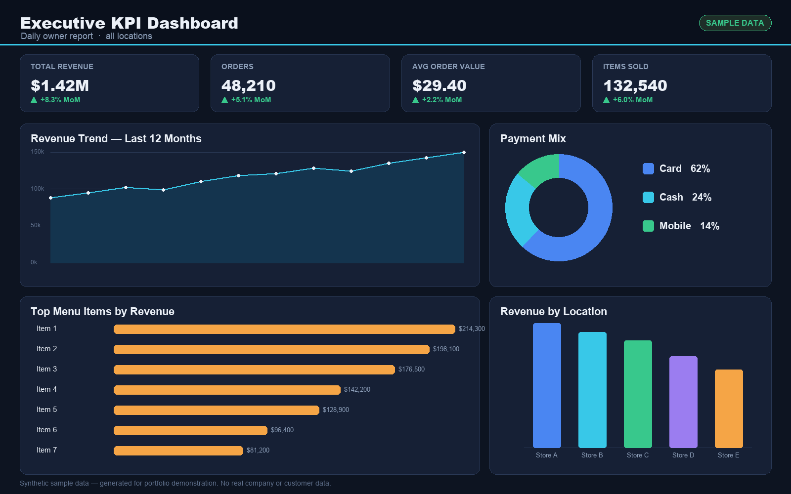
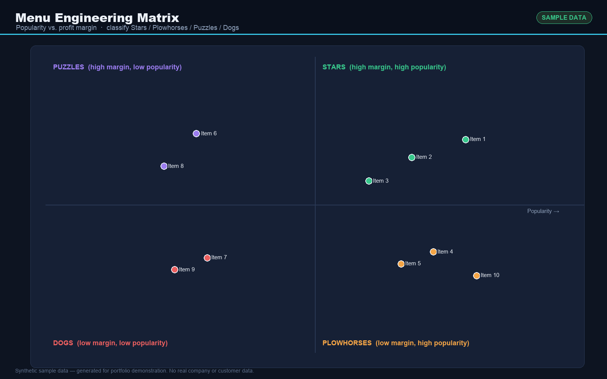
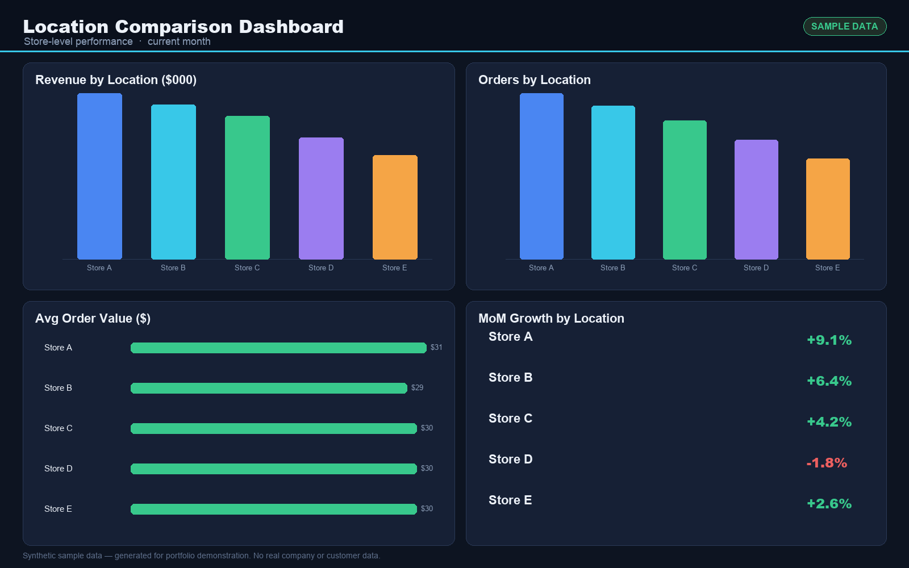
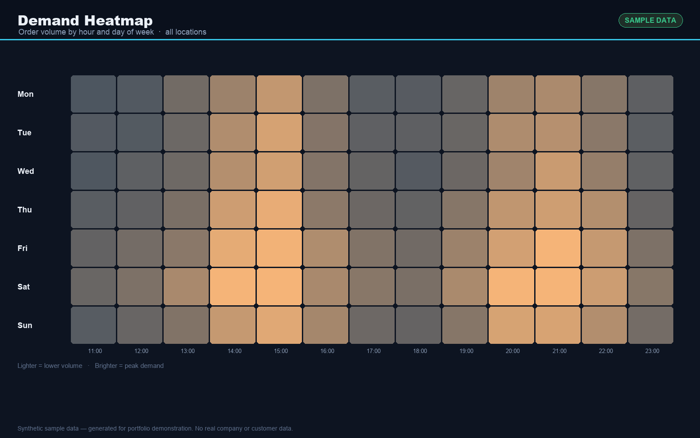
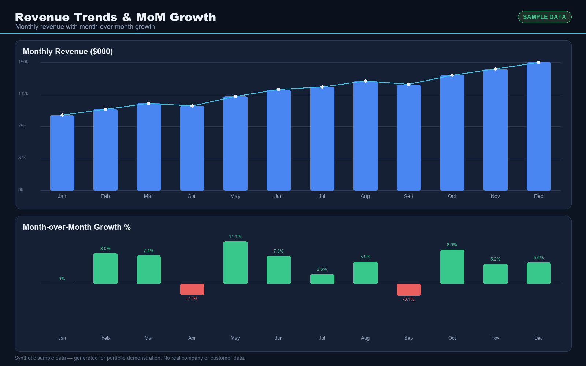
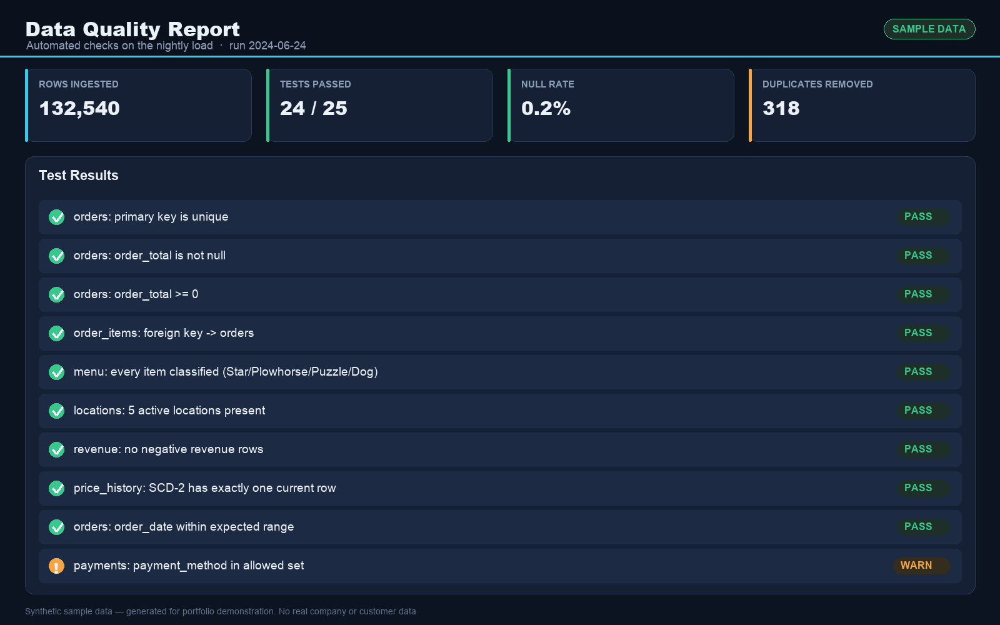
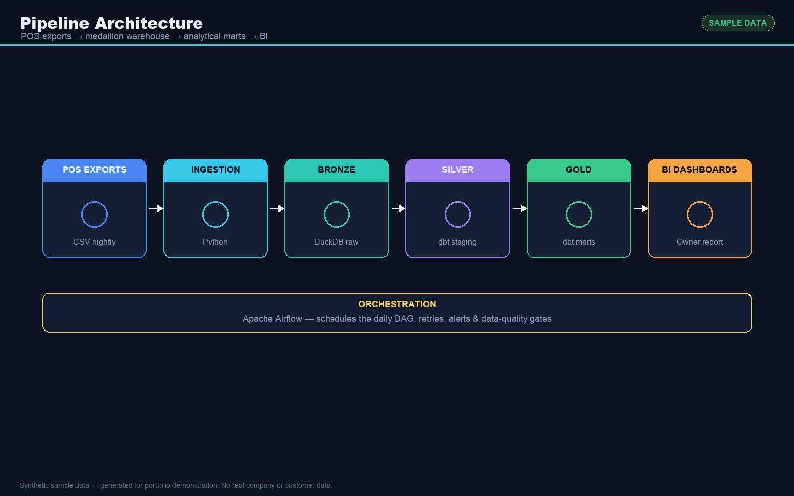
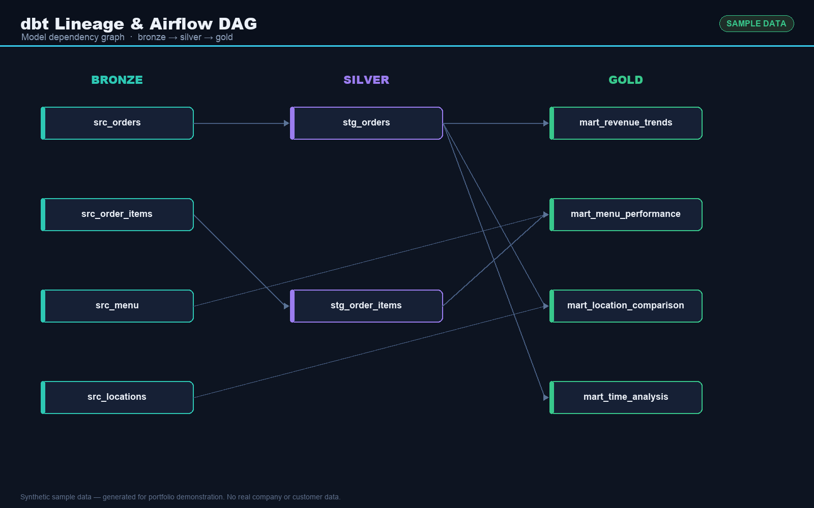

# Multi-Location Restaurant Analytics Pipeline

A batch data pipeline that turns nightly POS exports from a multi-location
restaurant business into clean, analytics-ready marts and a daily owner report.

> Portfolio project on **synthetic data**. `code/ingestion/generate_sample_data.py`
> creates a full year of fake POS exports for five generic locations (LOC-01 to LOC-05);
> no real company or customer data is used.

## Business Problem
A multi-location restaurant operator needs visibility into:
- Which menu items are actually profitable vs. just popular (menu engineering)
- How each location performs month-over-month
- When peak demand occurs by hour and day
- How menu prices change over time (price history ingested with SCD Type 2 fields: `effective_from`, `effective_to`, `is_current`; the margin marts currently use current cost prices)

## Architecture
POS exports (CSV) → ingestion (Python, schema validation, incremental watermark) → Bronze tables (DuckDB)
→ 18 SQL quality checks (fail the run on any violation) → dbt models: Bronze views → Silver (incremental)
→ Gold marts → dbt tests → daily owner report (CSV exports + email). Orchestrated with Apache Airflow.

| Layer | Models |
|---|---|
| Bronze (views) | `src_orders`, `src_order_items`, `src_menu`, `src_locations` |
| Silver (incremental) | `stg_orders` (time dimensions, day part, weekend flag), `stg_order_items` (cost, gross profit, margin) |
| Gold (tables) | `mart_menu_performance` (Star / Plow Horse / Puzzle / Dog), `mart_location_comparison`, `mart_time_analysis`, `mart_revenue_trends` (MoM + YTD) |

**Tests:** 18 Bronze quality checks in `code/validation/quality_checks.py` (keys, valid locations and order types, totals = subtotal + tax, date range, closed days, item prices, menu food cost ≤ 45%) plus 20 dbt tests (`unique` / `not_null` and singular tests for menu classification, non-negative revenue and order totals).

## Stack
Python / SQL / dbt (dbt-duckdb) / DuckDB / Apache Airflow

## Project Structure
- `code/ingestion/` — `generate_sample_data.py` (synthetic POS exports), `ingest.py` (CSV → Bronze, incremental watermark)
- `code/validation/` — `quality_checks.py` (Bronze checks + JSON report)
- `code/transformation/` — `generate_reports.py` (Gold marts → report CSVs)
- `dbt_restaurant/` — medallion models (bronze / silver / gold), tests, macros, DuckDB profile
- `airflow/dags/` — daily DAG: files → ingest → checks → dbt bronze → silver → gold → dbt test → report → email
- `.env.example` — environment configuration template

## Running Locally

```bash
pip install -r requirements.txt
export PIPELINE_HOME=$PWD
export RESTAURANT_DB_PATH=$PWD/data/bronze/restaurant_bronze.duckdb
mkdir -p data/bronze

python code/ingestion/generate_sample_data.py        # data/raw/*.csv (use --scale 0.3 for a smaller run)
python code/ingestion/ingest.py                      # Bronze tables in DuckDB
python code/validation/quality_checks.py             # 18 checks; raises on any failure
(cd dbt_restaurant && dbt build --profiles-dir .)    # Bronze/Silver/Gold models + 20 tests
python code/transformation/generate_reports.py       # output/reports/*.csv
```

## Data
Synthetic data only. Generated files (`data/raw/`) and the DuckDB warehouse (`*.duckdb`) are git-ignored; regenerate them with the script above.

## Dashboards (illustrative)
Dashboard designs for the Gold layer, using synthetic sample values (generic store and item names). The numbers are illustrative and won't match a particular generator run.

| Executive KPIs | Menu Engineering |
|---|---|
|  |  |
| **Location Comparison** | **Demand Heatmap** |
|  |  |
| **Revenue Trends & MoM Growth** | **Data Quality Report** |
|  |  |
| **Pipeline Architecture** | **dbt Lineage & Airflow DAG** |
|  |  |
